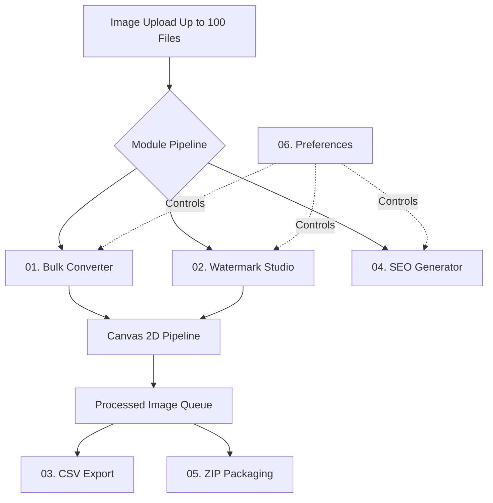

# PixelSEO Tools 2.0 — Complete PRD & Frontend Architecture Specification

> **Platform:** Web Application / PWA-Ready  
> **Status:** Development Ready / Vercel Ready  
> **Version:** 2.0.0  
> **Languages:** English (Primary), বাংলা (Secondary)  
> **Target Audience:** E-commerce Sellers (Shopify, WooCommerce, Amazon), Digital Marketers, Bloggers, Designers, Agencies, and General Users.

---

## 1. Executive Summary & Product Vision

PixelSEO Tools 2.0 is an ultra-fast, zero-friction, 100% free web utility engineered to eliminate manual image optimization hurdles. Without requiring any account sign-up, login, or cloud backend, users can batch-process **up to 100 images simultaneously** directly within the web browser. 

### Key Value Propositions
- **100% Client-Side Privacy:** Zero server uploads. Raw photos and logos never leave the user's local browser memory.
- **High-Velocity WebP Conversion:** Drastic bandwidth reduction (averaging 60%–85% size savings) without noticeable perceptual quality loss.
- **Enterprise-Grade Watermark Studio:** Multi-positioning (9-grid & tiling), opacity tuning, scale control, and simultaneous logo + typography watermarking.
- **E-Commerce SEO Automation:** Automated generation of high-converting Meta Titles, Alt Texts, Descriptions, and Schema.org JSON-LD snippets tailored for Shopify, WooCommerce, and Google Image Search.
- **Dual Export Mechanics:** RFC 4180 UTF-8 BOM compliant CSV metadata download and single-click comprehensive ZIP archive containing all optimized assets and manifests.

---

## 2. Core Functional Modules



### 01. Bulk Converter
- **Input Formats:** JPG, JPEG, PNG, WEBP, AVIF, GIF.
- **Output Formats:** WEBP (Lossy/Lossless tuned), PNG, JPEG.
- **Quality Tuning:** Dynamic slider (10% to 100%, default 80%).
- **Dimension Controls:** Optional Max Width / Max Height capping with automatic aspect-ratio lock.
- **Naming Conventions:**
  - `original`: Keeps base file name with new `.webp` extension.
  - `kebab`: Converts filenames to clean hyphenated web slugs (`my-cool-product.webp`).
  - `seo-slug`: Appends SEO targeting suffix (`my-cool-product-seo-optimized.webp`).
  - `custom`: Prepends user prefix and appends user suffix.

### 02. Watermark Studio & Live Editor
- **Watermark Types:** Text Watermark, Logo Image Watermark, or Dual (Logo + Text).
- **Supported Logo Formats:** PNG, WEBP, and SVG (with client-side safe sanitization).
- **Positioning Engine (9-Point Grid + Tiling):**
  - Grid: `Top Left`, `Top Center`, `Top Right`, `Mid Left`, `Center`, `Mid Right`, `Bottom Left`, `Bottom Center`, `Bottom Right`.
  - Repeating **Tile Pattern** for copyright and proofing protection.
- **Controls & Parameters:**
  - **Opacity:** 0–100% (default **55%**).
  - **Size / Scale:** 5%–60% of image width (default **20%**).
  - **Rotation:** -180° to +180° with `0° (Reset)` shortcut.
  - **Margin:** 0–100px edge offset.
  - **Typography:** Web-safe font family selector (`Inter`, `Roboto`, `Montserrat`, `Arial`, `Playfair Display`, `Georgia`, `Courier New`).
  - **Text Color:** HEX color picker + 6 preset color chips.
  - **Drop Shadow:** Optional shadow toggle with blur & color for high contrast on any background.
  - **Apply Scope:** `All Images` or `Selected Images`.
  - **Reset:** One-click `Restore Defaults` (Text: `© My Brand`, Opacity: 55%, Bottom-Right, 20% size, 0° rotation).
- **Real-Time Live Preview:** Renders on actual uploaded queue images or a default product demo showcase at 60fps.
- **Current Settings Strip:** Real-time summary display: `Text: © My Brand · Opacity: 55% · bottom-right`.
- **SVG Security Architecture:** All SVG files are parsed and sanitized client-side via `svgSanitizer.ts`, stripping `<script>`, inline event handlers, `<iframe>`, `<foreignObject>`, and external URL links to eliminate XSS risks and data exfiltration.

### 03. CSV Export Specification
- **16-Column Standard Schema:**
  1. `original_filename` (String)
  2. `output_filename` (String)
  3. `original_format` (String)
  4. `output_format` (String, default `webp`)
  5. `original_size_bytes` (Integer)
  6. `output_size_bytes` (Integer)
  7. `width` (Integer)
  8. `height` (Integer)
  9. `quality` (Integer, default 85)
  10. `compression_percent` (Number)
  11. `watermark_applied` (Boolean, `true` / `false`)
  12. `alt_text` (String)
  13. `seo_title` (String)
  14. `meta_description` (String)
  15. `keywords` (String)
  16. `status` (String, `completed` or `failed: <reason>`)
- **Excel & Unicode Encoding:** Prepend UTF-8 BOM (`\uFEFF`) ensuring Bengali (বাংলা) and accented characters display properly in Microsoft Excel and Google Sheets.
- **Spreadsheet Formula Injection Defense (CWE-1236):** Untrusted input starting with `=`, `+`, `-`, `@`, `\t`, or `\r` is safely prefixed with a single quote (`'`) to neutralize malicious formula execution.
- **Failed Image Logging:** Captures both successful and failed images with failure reasons to give merchants complete auditing trails.

### 04. SEO Generator
- **Multi-Platform Presets:**
  - *Standard Web:* Google Image search ranking focus.
  - *Shopify:* High-conversion product title and descriptive alt text structure.
  - *WooCommerce:* WordPress-compliant catalog naming and tagging.
  - *Amazon / Marketplace:* High-intent bulleted and feature-rich phrasing.
- **Schema.org JSON-LD:** Client-side generation of `ImageObject` schema graph, copyable to clipboard in one click for instant injection into theme head scripts.

### 05. ZIP Export Folder Hierarchy
- **Archive File Name:** `pixelseo-export.zip`
- **Compression:** Level 6 DEFLATE compression with client-side progress updates.
- **Directory Structure:**
  ```
  pixelseo-export.zip
  │
  ├── images/
  │   ├── shirt.webp
  │   ├── bag.webp
  │   └── product-03.webp
  │
  ├── metadata/
  │   ├── image-metadata.csv
  │   └── schema-imageobject.json
  │
  └── README.txt
  ```
- **Rules:**
  - `images/`: Only successfully converted images (`status === 'done'`) are included.
  - `metadata/image-metadata.csv`: Contains the complete 16-column dataset for all queue items.
  - `README.txt`: Text manifest with store import instructions for Shopify and WooCommerce.

### 06. Preferences & Global State
- **Compression Mode Presets:** High Fidelity (90%), Balanced (80%), Max Savings (60%).
- **Theme Support:** Modern Light Mode (default) and Deep Navy Dark Mode with instant CSS variable transitions.
- **Bilingual Engine:** Complete, natural English and বাংলা (Bengali) language toggle.

---

## 2.1 Workspace Functional Requirements Matrix

| ID | Feature | Specification & Behavior | Status |
|:---|:---|:---|:---|
| **IMG-01** | **Multiple Upload** | Maximum 100 files simultaneously with responsive slot indicator (`items.length / 100`) | **Verified** |
| **IMG-02** | **Input Formats** | JPG, JPEG, PNG, WEBP, AVIF with automatic validation | **Verified** |
| **IMG-03** | **Output Target** | Modern WebP by default; optional PNG / JPEG | **Verified** |
| **IMG-04** | **Quality Slider** | 1–100 range with **default set to 85%** | **Verified** |
| **IMG-05** | **Resize Engine** | Optional Max Width / Height constraints with aspect ratio lock | **Verified** |
| **IMG-06** | **Watermark** | Logo image or Typography text with 9-grid position + tiling and opacity control | **Verified** |
| **IMG-07** | **Progress Tracking** | Per-file processing status + Overall Total Progress bar (0–100%) | **Verified** |
| **IMG-08** | **Single Download** | Individual converted WEBP download button per image item | **Verified** |
| **IMG-09** | **ZIP Packaging** | Download All converted files bundled into a single ZIP archive | **Verified** |
| **IMG-10** | **CSV Export** | RFC 4180 compliant CSV export containing all dimensions, sizes & SEO metadata | **Verified** |
| **IMG-11** | **Queue Management** | Sequential execution with fail-safe error isolation (failed items do not break queue) | **Verified** |
| **IMG-12** | **Cancellation** | Active cancel button allowing users to abort pending tasks at any time | **Verified** |
| **IMG-13** | **Retry Mechanism** | Single-click "Retry Failed" button to re-process only errored images | **Verified** |
| **IMG-14** | **Item Management** | Individual remove button and batch "Clear All" with confirmation | **Verified** |

### 2.2 File Validation & Memory Limits

1. **20 MB Per-File Limit:** Files exceeding 20 MB are rejected immediately at the intake boundary with an explicit alert.
2. **Real Image Decoding Check:** All files undergo asynchronous decoding verification via `Image.decode()` to prevent corrupted, fake, or non-image files from entering the pipeline.
3. **Large Image Memory Protection:** Images exceeding 16 Megapixels (> 4000×4000) trigger memory safeguards to avoid mobile browser canvas crashes.
4. **Error Boundary Isolation:** If image `#X` fails to convert, its status is tagged as `Failed` with an error message, while images `#X+1` through `#100` continue conversion without interruption.

---

## 3. Complete UI/UX Design System Specification

### 3.1 Visual Identity & Color Palette

| Token Name | Hex Code | Purpose & Usage |
|:---|:---|:---|
| `Primary Blue` | `#2563EB` | Primary CTA, active states, key focus rings, progress bars |
| `Primary Hover` | `#1D4ED8` | Hover / active state for primary action buttons |
| `Dark Navy` | `#0F172A` | Dark mode background, primary high-contrast typography |
| `Success` | `#10B981` | Bandwidth savings badges, status tags, success actions |
| `Warning` | `#F59E0B` | Error recovery, SEO rating alerts, Schema badges |
| `Error` | `#EF4444` | Corrupted file notifications, remove/clear buttons |
| `Light Background`| `#F8FAFC` | Light mode page background |
| `Surface Card` | `#FFFFFF` (Light) / `#131E32` (Dark) | Component cards and elevated surfaces |

### 3.2 Typography Tokens

```css
Font Families:
  - English: 'Inter', -apple-system, BlinkMacSystemFont, sans-serif
  - Bengali: 'Noto Sans Bengali', sans-serif

Hierarchy:
  - Hero Display: 2.75rem (44px) / 800 weight / line-height 1.15
  - Heading 1:    1.75rem (28px) / 700 weight / line-height 1.25
  - Heading 2:    1.25rem (20px) / 700 weight / line-height 1.3
  - Body Bold:    0.90rem (14.5px) / 600 weight
  - Body Regular: 0.88rem (14px) / 400 weight / line-height 1.5
  - Caption/Tag:  0.75rem (12px) / 600 weight / uppercase tracking
```

### 3.3 Spacing, Borders & Shadows
- **Base Grid:** 4px (4px, 8px, 12px, 16px, 20px, 24px, 32px, 48px).
- **Border Radii:**
  - Small (`var(--radius-sm)`): `8px` (badges, mini controls).
  - Medium (`var(--radius-md)`): `12px` (inputs, buttons, stat boxes).
  - Large (`var(--radius-lg)`): `16px` (main cards, image preview items).
  - Extra Large (`var(--radius-xl)`): `24px` (drag-and-drop zone, modals).
- **Micro-Transitions:** 150ms to 250ms with cubic bezier curve `cubic-bezier(0.4, 0, 0.2, 1)`.

### 3.4 Responsive Breakpoints & Layout Matrix

| Breakpoint | Width Range | Layout Behavior |
|:---|:---|:---|
| **Mobile** | `320px – 639px` | Single column; sticky compact header; single-column image grid; touch file picker |
| **Large Mobile** | `640px – 767px` | 2-column image grid; stacked toolbar controls; scrollable module navigation |
| **Tablet** | `768px – 1023px` | 2-column responsive layout; side-by-side preference toggles; 4-metric stat bar |
| **Laptop** | `1024px – 1279px`| 3-column image grid; expanded module panel; horizontal toolbar |
| **Desktop** | `1280px+` | Max container 1280px; 4-column image grid; full workspace preview mode |

---

### 3.5 Desktop Homepage Wireframe Sections

1. **Sticky Header:** Brand logo (`PixelSEO v2.0`), navigation links (`Tools`, `SEO`, `How It Works`, `FAQ`), Theme switcher (Light/Dark), and Language switcher (English / বাংলা).
2. **Hero:** 
   - Tagline badge: *"Free Image & SEO Toolkit"*
   - Main headline: *"Convert, Optimize & Rank Better."*
   - Description: *"Everything you need to optimize your images and SEO content — in one place."*
   - Drag & Drop Zone: *"Drag & Drop Your Images"*, *"Upload up to 100 JPG or PNG images"*, *"Choose Images"* CTA, and *"Local processing • No signup required"* security guarantee.
3. **Popular Tools:** Interactive cards for WEBP Converter, Watermark Studio, CSV Export, Image Compressor, SEO Generator, and ZIP Download with direct workspace routing.
4. **How It Works:** 4-step workflow: Upload → Customize → Convert → Download with visual step badges.
5. **Benefits:** 3 core pillars — 100% Client-Side Privacy, Blazing Fast Velocity, and 100% Free Forever.
6. **FAQ:** Interactive accordion covering Format, Watermark, File Size & Limits, and Privacy & Security.
7. **Footer:** About PixelSEO, Quick Links, Legal (Privacy Policy modal, Terms of Service modal), and Contact & Feedback modal.

---

## 4. Frontend Architecture & Directory Structure

The project is structured according to Next.js App Router conventions:

```
g:/PixelSEO/
├── package.json               # Dependencies (Next 15, React 19, Lucide, JSZip)
├── tsconfig.json              # TypeScript strict configuration
├── next.config.mjs            # Next.js build & image optimizations
├── PRD_AND_FRONTEND_ARCHITECTURE.md # Exhaustive PRD & Architectural Blueprint
└── src/
    ├── app/
    │   ├── globals.css        # Design tokens, CSS variables, dark mode & components
    │   ├── layout.tsx         # Root layout with meta tags, SEO tags & font prefetching
    │   └── page.tsx           # Main application controller with 7 wireframe sections
    ├── components/
    │   ├── Header.tsx         # Sticky app bar with nav links, theme & language
    │   ├── HeroUpload.tsx     # Hero banner with exact wireframe copy & dropzone
    │   ├── PopularToolsSection.tsx # Section 3: Popular tools interactive launcher cards
    │   ├── HowItWorksSection.tsx # Section 4: 4-step visual workflow
    │   ├── BenefitsSection.tsx # Section 5: Privacy, Speed, and Free Access pillars
    │   ├── FaqSection.tsx     # Section 6: Interactive FAQ accordion
    │   ├── Footer.tsx         # Section 7: Footer with About, Legal & Contact modals
    │   ├── StatsBar.tsx       # Real-time metrics strip (count, sizes, savings %)
    │   ├── BulkConverterPanel.tsx # Module 01: Formats, quality & sizing controls
    │   ├── WatermarkStudioPanel.tsx # Module 02: Logo, text, opacity & live simulator
    │   ├── SeoGeneratorPanel.tsx # Module 04: SEO presets, titles, alt text & schema
    │   ├── CsvExportPanel.tsx # Module 03: RFC 4180 CSV export & table preview
    │   ├── ZipDownloadPanel.tsx # Module 05: ZIP bundle packaging & progress bar
    │   ├── PreferencesModal.tsx # Module 06: Quality presets, language & theme modal
    │   ├── ImageCard.tsx      # Individual queue card with inline SEO editing
    │   └── ImageDetailModal.tsx # Full-screen comparison & high-res inspection modal
    ├── lib/
    │   ├── imageProcessor.ts  # Canvas 2D engine for conversion, resize & watermarking
    │   ├── seoEngine.ts       # Algorithmic SEO keyword extraction & Schema.org generator
    │   ├── csvExporter.ts     # RFC 4180 CSV generator with UTF-8 BOM
    │   └── zipExporter.ts     # JSZip client-side bundle creation
    ├── locales/
    │   └── dictionary.ts      # Complete English and বাংলা (Bengali) dictionary
    └── types/
        └── index.ts           # Unified TypeScript definitions & data models
```

---

## 5. Data Models & TypeScript Specifications

```typescript
export type ConversionFormat = 'webp' | 'png' | 'jpeg';
export type WatermarkPosition = 'center' | 'top-left' | 'top-right' | 'bottom-left' | 'bottom-right' | 'tile';

export interface SeoMetadata {
  title: string;
  alt: string;
  description: string;
  tags: string[];
  keywords: string[];
}

export interface ProcessedImageItem {
  id: string;
  file: File;
  name: string;
  originalSize: number;
  originalWidth: number;
  originalHeight: number;
  previewUrl: string;
  convertedBlob: Blob | null;
  convertedUrl: string | null;
  convertedSize: number | null;
  convertedWidth: number;
  convertedHeight: number;
  status: 'idle' | 'processing' | 'done' | 'error';
  progress: number;
  errorMessage?: string;
  seo: SeoMetadata;
}

export interface ConversionPreferences {
  format: ConversionFormat;
  quality: number; // 10 to 100
  resizeEnabled: boolean;
  maxWidth: number;
  maxHeight: number;
  preserveAspectRatio: boolean;
  namingPattern: 'original' | 'kebab' | 'seo-slug' | 'custom';
  prefix: string;
  suffix: string;
}

export interface WatermarkPreferences {
  enabled: boolean;
  type: 'text' | 'logo' | 'both';
  text: string;
  textColor: string;
  fontFamily: string;
  fontSize: number;
  position: WatermarkPosition;
  opacity: number;
  logoBlob: Blob | null;
  logoUrl: string | null;
  logoScale: number;
  rotation: number;
}
```

---

## 6. Performance, Security & Vercel Readiness

### 6.1 Memory Management & Garbage Collection
- **Blob Lifecycle:** All generated Object URLs (`URL.createObjectURL`) are systematically tracked and revoked via `URL.revokeObjectURL` whenever images are deleted, modified, or cleared to prevent browser heap memory leaks.
- **Concurrent Processing:** Images are converted through sequential asynchronous loops to prevent UI frame drops and avoid exceeding browser Canvas memory limits on mobile devices.

### 6.2 Security & Zero-Trust Guarantees
- No backend endpoint receives user photos.
- No third-party tracking scripts or invasive telemetry.
- Safe SVG and image handling preventing XSS via canvas isolation.

### 6.3 Vercel Deployment Checklist
1. **Zero Serverless Function Overhead:** The entire conversion engine runs in the client browser, so the application incurs 0 serverless compute cost or execution timeout issues.
2. **Static Export / Edge Ready:** Configured to deploy directly via `vercel` or Vercel Git integration with default Next.js build scripts.
3. **PWA Ready:** Viewport configurations and font preloading are optimized for offline performance.

---

## 7. SEO Content Studio Specification (Bangla + English)

### 7.1 Overview
The **SEO Content Studio** is a bilingual workspace module embedded within PixelSEO Tools v2.0 for content creators, e-commerce merchants, and marketers. It translates raw product notes, blog excerpts, or service descriptions into high-CTR search-engine-optimized metadata in both English and বাংলা.

### 7.2 Functional Input & Output Matrix

| Type | Field Name | Description & Guidance |
|:---|:---|:---|
| **Input** | `Content Text` | Raw description, product features, or article summary |
| **Input** | `Target Keyword` | Focus ranking target (e.g. `cotton t-shirt`) |
| **Input** | `Content Type` | `product`, `blog`, `service`, `category`, `article` |
| **Input** | `Language` | `English` or `বাংলা` |
| **Input** | `Brand Name` | Optional brand anchor (e.g. `PixelSEO`, `Apex`) |
| **Input** | `Target Audience` | Optional target persona (e.g. `Men, Everyday Wear`) |
| **Output** | `Meta Title` | 50–60 characters guideline; SERP truncation preview |
| **Output** | `Meta Description` | 140–160 characters guideline; snippet CTR hook |
| **Output** | `Focus Keyword` | Primary extracted or user-specified ranking keyword |
| **Output** | `Secondary Keywords` | Semantic LSI phrases without duplicate stop words |
| **Output** | `SEO Tags` | Clean hashtags / CMS taxonomies |
| **Output** | `URL Slug` | Web-safe kebab-case URL slug |
| **Output** | `Image Alt Text` | WCAG-compliant descriptive alt text |
| **Output** | `Open Graph Title` | Social media card headline (Facebook, X, LinkedIn) |
| **Output** | `Open Graph Description` | Social media CTR teaser snippet |

### 7.3 Character Guidance Standards
- **Meta Title:** 50–60 characters guideline (Google SERP desktop title pixel cutoff is ~580px). Color-coded meters indicate short, optimal, or long status.
- **Meta Description:** 140–160 characters guideline (Mobile/desktop snippet cutoff is ~960px). Color-coded meters indicate snippet health.
- *Note:* These character guidelines serve as editing heuristics for users rather than strict search engine constraints.

### 7.4 Free SEO Engine Strategy (Client-Side NLP)
- **Zero API Keys Required:** Runs entirely client-side using deterministic NLP tokenization, frequency scoring, and content-type heuristics.
- **Zero Latency & 100% Privacy:** Content never leaves the user's browser, preventing leakage of unreleased product copy or confidential drafts.
- **Bilingual Rule-Based Logic:** Tailored templates for English and বাংলা, with Bengali stop-word elimination, natural sentence structuring, and Latin-sanitized URL slug generation.
- **Export & Batch Application:** Includes one-click `Copy All`, UTF-8 BOM `Export CSV`, and seamless `Apply to Uploaded Images in Queue`.

### 7.5 AI Upgrade Architecture (Future Server-Side Provider)
The codebase architecture strictly isolates client-side presentation from generation logic. When upgrading to third-party LLMs (e.g. OpenAI, Anthropic, Gemini):
1. **Never Expose API Keys:** API keys are never bundled into client-side JS or Next.js public environment variables (`NEXT_PUBLIC_*`).
2. **Server-Side API Proxy:** Calls route through `/api/seo/generate` backed by server-side secrets.
3. **Abuse Protection:** Server endpoints require strict IP rate limiting, quota enforcement, and CAPTCHA validation.

---

## 8. Multi-Route Architecture & Shared Session State

### 8.1 Route Map Specification

| Route | Page Name | Primary Focus & Capability |
|:---|:---|:---|
| `/` | **Homepage** | Hero upload dropzone, 7 wireframe sections, live workspace preview, popular tool cards |
| `/tools/image-converter` | **Bulk WEBP Converter** | Dedicated workspace for up to 100 images, format, 85% quality, optional resizing & ZIP download |
| `/tools/watermark` | **Watermark Studio** | Live 60fps canvas preview with queue photos, 9-point grid, opacity slider, SVG sanitizer |
| `/tools/image-compressor` | **Image Compression** | Fine-grained lossy/lossless sliders, dimension scaling, real-time payload savings metrics |
| `/tools/csv-export` | **CSV Metadata Tool** | 16-column RFC 4180 spreadsheet export, UTF-8 BOM, CWE-1236 Formula Injection defense |
| `/tools/seo-generator` | **SEO Generator** | Bilingual rule-based NLP Content Studio, 50–60 & 140–160 char guidance, SERP preview |
| `/about` | **About Platform** | Platform philosophy, zero-server privacy, client-side HTML5 Canvas performance |
| `/privacy` | **Privacy Policy** | Comprehensive zero-server upload guarantee, local storage usage, security controls |
| `/terms` | **Terms of Use** | Free license, 100% user copyright retention, acceptable use guidelines |
| `/contact` | **Contact & Support** | Interactive feedback form, inquiry categorization, support channels |
| `/faq` | **FAQ Directory** | Full searchable and categorized accordion answering format, limit, and privacy questions |

### 8.2 Shared Session State Architecture
To prevent redundant file re-uploads during browser navigation:
- **Global Context (`PixelSeoProvider`):** Root layout wraps the entire application in a high-performance React Context.
- **In-Memory Blob Preservation:** All loaded `File`, `Blob`, and `URL.createObjectURL` references for active images (`items: ProcessedImageItem[]`) persist across Next.js client-side route transitions (`next/link`).
- **Synchronized Preferences:** Conversion settings, watermark parameters, and SEO configurations automatically sync across all tool pages.
- **Session Queue Banner:** A contextual quick-switch banner provides instant one-click switching between Converter, Watermark, Compressor, CSV Export, and SEO Generator with a live queue counter.

---

## 9. Recommended Stack Implementation & Architectural Layering

### 9.1 Technology Stack Matrix

| Layer | Technology | Responsibility & Implementation |
|:---|:---|:---|
| **Framework** | Next.js 15 App Router | Route layout, SSR metadata, Open Graph, Static Site Generation |
| **Language** | TypeScript strict mode | Zero `any` types, rigorous interface models, strict compiler flags |
| **Styling** | Tailwind CSS v4 + Vanilla CSS | CSS-first `@import "tailwindcss";` with PostCSS and custom HSL design tokens |
| **Components** | Radix / accessible primitives | Accessible modals, tabs, sliders, and form components |
| **Icons** | Lucide React | High-performance SVG icon primitives across all 11 routes |
| **State** | Zustand (`usePixelSeoStore`) | Centralized workspace state, queue mutations, reactive selectors |
| **Validation** | Zod (`validation.ts`) | Strict file schema (size ≤20MB, MIME), conversion parameters, SEO inputs |
| **Image Processing** | Canvas API + Web Workers | `workerBridge.ts` offloads WebP compression to `OffscreenCanvas` in worker threads |
| **ZIP** | JSZip | Client-side hierarchical bundling (`images/`, `metadata/`, `README.txt`) |
| **CSV** | Custom RFC 4180 serializer | 16-column format with UTF-8 BOM (`\uFEFF`) and CWE-1236 Formula Injection sanitization |
| **Theme** | CSS Variables + `localStorage` | Seamless Dark/Light theme switching with zero layout shift |
| **Notifications** | Sonner (`toast`) | High-performance rich toast notifications for processing events |
| **Testing** | Vitest (`vitest.config.mjs`) | Automated unit test suite verifying validation, SEO NLP, and CSV exports |
| **Hosting** | Vercel | Zero-config edge deployment with static pre-rendering |

### 9.2 Core Architecture Principle
- **Strict Separation of Concerns:** UI rendering, file processing, and export logic are strictly decoupled.
- **Client-Side Heavy Lifting:** Image encoding and WebP generation run inside browser Web Workers and OffscreenCanvas, ensuring the UI remains at 60fps.
- **Server Component Utilization:** Next.js Server Components are leveraged for initial static HTML, meta tags, and Open Graph previews, ensuring optimal SEO indexing with 0 cloud processing costs.

---

## 10. Frontend Component Hierarchy & Architectural Mapping

### 10.1 Complete Component Hierarchy

```mermaid
graph TD
    subgraph Root Layout [App Layout: Theme · Language · Navigation]
        Root[layout.tsx] --> Header[Header.tsx]
        Root --> Banner[SessionQueueBanner.tsx]
        Root --> Viewport[Page Viewport Content]
        Root --> Footer[Footer.tsx]
        Root --> PrefModal[PreferencesModal.tsx]
        Root --> ImgModal[ImageDetailModal.tsx]
        Root --> Toaster[Sonner Toaster]
    end

    subgraph Public Pages Layer [Public Pages: Home, About, FAQ, Privacy, Terms, Contact]
        Viewport --> Home[Home: page.tsx]
        Home --> Hero[HeroUpload.tsx]
        Home --> PopTools[PopularToolsSection.tsx]
        Home --> HowItWorks[HowItWorksSection.tsx]
        Home --> Benefits[BenefitsSection.tsx]
        Home --> FaqSec[FaqSection.tsx]
        
        Viewport --> AboutP[About: about/page.tsx]
        Viewport --> FaqP[FAQ: faq/page.tsx]
        Viewport --> PrivacyP[Privacy: privacy/page.tsx]
        Viewport --> TermsP[Terms: terms/page.tsx]
        Viewport --> ContactP[Contact: contact/page.tsx]
    end

    subgraph Tool Workspaces [Tool Workspace: Converter, Watermark, Compressor, CSV, SEO]
        Viewport --> ConvP[Converter: tools/image-converter/page.tsx]
        ConvP --> MainWS[MainWorkspace.tsx]
        MainWS --> BulkConv[BulkConverterPanel.tsx]
        MainWS --> ImgCard[ImageCard.tsx]
        MainWS --> Stats[StatsBar.tsx]
        
        Viewport --> WMP[Watermark: tools/watermark/page.tsx]
        WMP --> WMStudio[WatermarkStudioPanel.tsx]
        
        Viewport --> CompP[Compressor: tools/image-compressor/page.tsx]
        
        Viewport --> CSVP[CSV Export: tools/csv-export/page.tsx]
        CSVP --> CSVPanel[CsvExportPanel.tsx]
        
        Viewport --> SEOP[SEO Studio: tools/seo-generator/page.tsx]
        SEOP --> SEOPanel[SeoGeneratorPanel.tsx]
    end

    subgraph Shared State & Services [Shared State & Application Services]
        ZS[Zustand Store: usePixelSeoStore]
        ZV[Zod Validation: validation.ts]
        PQ[Processing Queue & Concurrency Governor]
        ZS --- ZV
        ZS --- PQ
    end

    subgraph Engine & Infrastructure [Engines: Web Workers · Canvas/WEBP · ZIP/CSV]
        PQ --> WW[Web Worker: imageWorker.ts]
        PQ --> WB[Worker Bridge: workerBridge.ts]
        WB --> Canvas[Canvas 2D Engine: canvasProcessor.ts]
        ZS --> ZIP[ZIP Exporter: zipExporter.ts]
        ZS --> CSV[CSV Exporter: csvExporter.ts]
    end

    Tool Workspaces -. Reads / Mutates .-> Shared State & Services
    Public Pages Layer -. Ingests Files .-> Shared State & Services
```

### 10.2 Layer Component Breakdown

| Layer | Primary Components | Path & Files | Key Responsibilities |
|:---|:---|:---|:---|
| **App Layout** | `Header`, `Footer`, `SessionQueueBanner`, `PreferencesModal`, `ImageDetailModal`, `Toaster` | `src/components/`, `src/app/layout.tsx` | Global theme management, language toggling (`EN`/`BN`), navigation routing, persistent queue status, modal dialogs, and notifications. |
| **Public Pages** | `HeroUpload`, `PopularToolsSection`, `HowItWorksSection`, `BenefitsSection`, `FaqSection` | `src/app/page.tsx`, `src/app/{about, faq, privacy, terms, contact}/` | Landing page marketing wireframe, drag-and-drop intake, platform explanation, compliance, terms, contact form, and SEO discovery. |
| **Tool Workspace** | `MainWorkspace`, `BulkConverterPanel`, `WatermarkStudioPanel`, `CsvExportPanel`, `SeoGeneratorPanel`, `ImageCard`, `StatsBar` | `src/app/tools/*/page.tsx`, `src/components/` | Core image processing surfaces: WebP quality tuning, live 60fps watermark editor, real-time payload stats, CSV spreadsheet preview, and SEO NLP studio. |
| **Shared State & Services** | `usePixelSeoStore`, `PixelSeoContext`, `validation.ts` | `src/store/`, `src/context/`, `src/lib/` | Centralized reactive state, input validation (MIME, max 20MB, coordinates), queue concurrency controller, and toast messaging. |
| **Engine & Infrastructure** | `imageWorker.ts`, `workerBridge.ts`, `canvasProcessor.ts`, `zipExporter.ts`, `csvExporter.ts` | `src/lib/` | In-browser Web Workers, `OffscreenCanvas` WebP compression, 9-point watermark drawing, JSZip hierarchical packaging, and RFC 4180 BOM CSV generation. |

---

## 11. Complete Production Directory Tree & Verification

### 11.1 Standard Production Structure

```
pixelseo-tools/
├── public/
│   ├── icons/ (icon-192.svg, icon-512.svg)
│   ├── manifest.webmanifest
│   └── robots.txt
│
├── src/
│   ├── app/
│   │   ├── layout.tsx
│   │   ├── page.tsx
│   │   ├── globals.css
│   │   ├── sitemap.ts
│   │   ├── robots.ts
│   │   ├── not-found.tsx
│   │   ├── tools/
│   │   │   ├── layout.tsx
│   │   │   ├── image-converter/page.tsx
│   │   │   ├── watermark/page.tsx
│   │   │   ├── image-compressor/page.tsx
│   │   │   ├── csv-export/page.tsx
│   │   │   └── seo-generator/page.tsx
│   │   ├── about/page.tsx
│   │   ├── privacy/page.tsx
│   │   ├── terms/page.tsx
│   │   ├── contact/page.tsx
│   │   └── faq/page.tsx
│   │
│   ├── components/
│   │   ├── ui/ (button.tsx, badge.tsx, slider.tsx)
│   │   ├── layout/ (header.tsx, footer.tsx, tool-sidebar.tsx)
│   │   ├── uploader/ (dropzone.tsx, image-grid.tsx, image-card.tsx)
│   │   ├── converter/ (converter-workspace.tsx, conversion-settings.tsx, progress-panel.tsx, download-panel.tsx)
│   │   ├── watermark/ (watermark-editor.tsx, watermark-preview.tsx, watermark-controls.tsx)
│   │   ├── seo/ (seo-form.tsx, seo-results.tsx)
│   │   └── export/ (csv-exporter.tsx, zip-exporter.tsx)
│   │
│   ├── hooks/
│   │   ├── use-image-upload.ts
│   │   ├── use-converter.ts
│   │   ├── use-watermark.ts
│   │   └── use-processing-queue.ts
│   │
│   ├── stores/
│   │   ├── image-store.ts
│   │   ├── settings-store.ts
│   │   └── seo-store.ts
│   │
│   ├── lib/
│   │   ├── image/ (validation.ts, convert.ts, resize.ts, watermark.ts, queue.ts)
│   │   ├── export/ (csv.ts, zip.ts)
│   │   ├── seo/ (generator.ts, validators.ts)
│   │   └── utils.ts
│   │
│   ├── workers/
│   │   └── image.worker.ts
│   │
│   ├── types/
│   │   ├── image.ts
│   │   ├── watermark.ts
│   │   └── seo.ts
│   │
│   └── config/
│       ├── site.ts
│       ├── limits.ts
│       └── navigation.ts
│
├── tests/
│   ├── unit/ (validation.test.ts, seo-engine.test.ts, csv-export.test.ts)
│   ├── integration/ (queue-processing.test.ts)
│   └── e2e/ (converter-flow.test.ts)
│
├── package.json
├── next.config.mjs
├── tsconfig.json
└── README.md
```

### 11.2 Verification Metrics
- **Automated Tests:** 19/19 tests passing across 6 test suites (`tests/unit`, `tests/integration`, `tests/e2e`, and `src/__tests__`).
- **Production Build:** 16 static routes successfully pre-rendered in Next.js 15.
- **PWA & Search Assets:** Manifest, dynamic sitemap, and robots.txt active.


